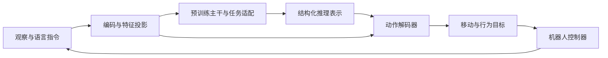

# 从零理解 MobileVLA-R1 2.0

本文是本学习仓库的通俗笔记，用来解释我们准备学习和验证什么。作者的实验结论、我们的运行记录、未来实验计划是三类不同证据。

**状态基准：2026-10-18 07:47（北京时间）的最后已核实回执。那时本任务尚未触发训练，没有参数更新、训练检查点或导航成绩；其后状态未知。** 后续路线与验收要求见 [路线与评测](05-roadmap-and-evaluation.md)。

## 1. 整个任务是什么

设想给机器人一句话：“绕过障碍，走到红色门旁边。”机器人需要不断回答三个问题：眼前有什么？现在应该往哪里走？下一小段动作如何执行？这是教学示例，不是新增训练标签。

VLA 是 Vision–Language–Action，即“视觉—语言—动作”。在一个闭环中，机器人先观察，再根据指令决定动作；执行一小段后重新观察，继续修正。闭环很重要：只对一张图片输出一次答案，还不能说明机器人能完成整条路线。

| 部分 | 初学者可以怎样理解 | 常见误解 |
|---|---|---|
| Vision：观察 | 从图像等传感信息判断环境 | 能加载图片就等于理解场景 |
| Language：指令 | 确定目标、顺序和限制 | 只要回答通顺，动作就正确 |
| Action：动作 | 给出可执行的移动或行为目标 | 大模型直接控制每个电机 |
| Controller：控制器 | 把任务目标实现为机器人实际运动 | 换机器人时只要复制模型文件 |

学习本项目的核心问题是：**文字指令和眼前观察，如何变成持续有效的机器人决策？**

## 2. 多模态不是“多放几份文件”

模态可以理解为不同种类的信息。普通彩色图像容易表达颜色和物体外观；深度描述距离；点云把空间采样表达为三维点。它们需要各自正确的编码和对齐，才能共同帮助判断空间关系。

| 信息 | 适合回答的问题 | 使用前要检查 |
|---|---|---|
| RGB | 目标长什么样、在哪里出现 | 图像顺序、预处理、来源 |
| 深度 | 物体离相机多远 | 单位、无效值、是否保留物理尺度 |
| 点云 | 三维空间怎样分布 | 坐标系、特征列、标定和编码器要求 |
| 语言与历史 | 当前目标是什么、之前做过什么 | 指令、时间对应、长度和标签格式 |

编码器把原始观测转换为数值特征，投影器再把不同特征接到同一个模型中。“缓存特征”表示提前完成编码器计算，可以减少重复计算；它必须保留来源、编码器版本、预处理与张量形状，不能用任意同形状数组替代真实观察。当前代码对这些接口有明确约定，见 [官方数据规范](https://github.com/AIGeeksGroup/MobileVLA-R1-2.0/blob/eb254bdaf2c378454352bfa0e82a15a061de03b7/docs/data.md)。

我们曾用合成特征检查接口形状，也已用真实 RGB 编码得到缓存；这两种检查证明的范围不同。前者检查连接是否能运行，后者增加了真实图像这一证据，两者都不能代替完整三模态训练。

## 3. NaVILA、LLaMA3-8B 和动作解码器是什么关系

NaVILA 是已有的机器人导航模型工作，可以作为本项目的初始化基础；它也区分高层决策和低层运动。参见 [NaVILA 作者项目页](https://navila-bot.github.io/)。

“8B”表示语言主干约有八十亿参数，不是八十亿条训练数据。使用预训练底座，是在已有能力上适配任务，而不是从随机参数重新学习全部视觉和语言知识。模型名称相近也不保证权重可互换：结构、分词器、视觉编码器、投影器与加载接口都必须匹配。

作者的 2.0 方案以 NaVILA/LLaMA3-8B 为基础，把观察与推理表示交给可学习的动作解码器，输出平面移动速度、转向速度和行为类别，再由机器人控制器执行。相对 R1，重要变化是由可学习解码器替代确定性的文本动作解析；这也增加了单独训练、验证动作解码器的要求。[2.0 论文 §I、§IV](https://arxiv.org/html/2609.06251v1)

这个图用于理解模块之间的责任，并不是我们已经完成的机器人部署。

## 4. LoRA：主要学习哪些参数

微调是在现有模型上继续学习。LoRA 的做法是保留大部分预训练权重，在选定层加入较小的可训练矩阵来表达更新。可以把它理解为给已有系统增加一组可调的修正，而不是重写所有参数。[LoRA 原始论文](https://arxiv.org/abs/2106.09685)

需要分清三件事：

- 可训练参数少，不代表整个模型不占显存；冻结的主干仍要参与计算。
- LoRA 不是量化。前者改变如何适配参数，后者改变数值存储或计算精度，能否结合要另行验证。
- 只看到损失有数值还不够，必须确认目标参数确实更新，并能保存、重载。

## 5. 分阶段学习分别解决什么问题

当前 2.0 代码组织了以下训练顺序。阶段名称表示监督目标不同，不能通过改名把缺少动作标签的记录塞进下一阶段。[官方训练入口说明](https://github.com/AIGeeksGroup/MobileVLA-R1-2.0#-training)

| 阶段 | 教学理解 | 完成后还不能直接推断什么 |
|---|---|---|
| `long_sft` | 用 episode/nav 标注学习任务解释和结构化文字输出 | 不能因此认定动作解码器已经学会控制 |
| `action_sft` | 用 step 记录把观察、推理和真实动作监督连接起来，训练动作解码器 | 不能因此认定未知场景任务成功 |
| `grpo` | 对同一输入的多个候选作比较，强化较合适的输出 | 不能因此省略独立闭环评测 |

SFT 是监督微调，可以类比为“有示范答案的练习”。训练损失衡量模型输出与监督目标之间的差异。示范本身若错误、泄漏了测试答案或与图像错位，模型也可能顺利降低损失，因此数据检查是实验的一部分。

GRPO 的直观思想是比较同一组候选的相对表现，再调整生成这些候选的策略；方法来源可见 [DeepSeekMath 论文](https://arxiv.org/abs/2402.03300)。在本项目 2.0 方案中，它使用固定数据进行离线优化：根据动作一致性、行为匹配和格式计算奖励，动作解码器在这一阶段保持冻结。这不意味着机器人在训练期间实际到环境里行走试错。[2.0 论文 §IV-E](https://arxiv.org/html/2609.06251v1#S4.SS5)

推理文字主要用于表达中间决策和提供监督；文字看起来合理，不是正确控制或真实认知过程的充分证据。

## 6. Loss、SR、SPL 为什么要分开看

| 观察量 | 告诉我们什么 | 单独不能证明什么 |
|---|---|---|
| 训练 loss | 对训练监督的拟合程度 | 泛化能力、导航成功 |
| 离线动作误差或行为匹配 | 固定记录上的预测与标签是否接近 | 实际执行后是否到达目标 |
| SR：成功率 | 按既定规则，完整任务成功的比例 | 是否绕路、是否高效 |
| SPL：成功加权路径效率 | 同时考虑成功与路径长度 | 所有现实安全与控制质量 |
| NE：导航误差 | 终点与目标之间的距离误差 | 整条路线都正确或无碰撞 |

例如，100 个评测任务成功 70 个时，SR 是 70%；这是说明算法的假设例子，不是本项目成绩。两个策略可能成功次数相同，其中一个绕路更多，路径效率就不同。具体数值只能由固定环境、划分和成功判据下的真实运行产生。

对“机器人是否学会了”的检验要从离线预测继续走到闭环：观察改变，动作改变，再观察是否接近目标。作者报告了导航、四足任务与真机实验；那些是作者的结果，不是本学习仓库已经重现的结果。[2.0 作者展示页](https://aigeeksgroup.github.io/MobileVLA-R1-2.0/)

阅读论文结果时，可以先关注下列两个目标。数值来自作者的实验表；本次学习复现尚无对应测量，不能填写成相同成绩。[论文 §V-B](https://arxiv.org/html/2609.06251v1#S5.SS2)

| 指标 | 作者报告的 2.0 结果 | 本次实验 |
|---|---:|---|
| R2R-CE val-unseen 任务成功率 SR | 69.8% | 未评测 |
| QUARD 六任务平均成功率 | 76% | 未评测 |

比较成绩前还要对齐数据划分、模态、环境和成功判据。换成 RGB 小样本训练所得的结果，只能按实际设置报告。

## 7. 现在应该掌握的学习要点

1. 能指出一条训练记录中的观察、指令、推理和目标，并说明哪些字段有原始证据。
2. 能画出编码器、主干、适配参数、动作解码器和控制器的位置。
3. 能解释前向计算、反向传播、参数更新、保存重载分别在验证什么。
4. 能区分训练样本、验证样本和测试样本，解释同一轨迹的相邻帧为什么容易造成泄漏。
5. 能说明离线动作准确与闭环任务成功为何不是同一件事。
6. 能把一个实验结论对应到实际数据、配置、日志和评测输出，而不是只看模型名称。

## 8. 与域随机化的关系

域随机化是有计划地改变训练环境或观测条件，例如颜色、光照、纹理或传感噪声，再检查模型对变化是否更稳健。它是一项需要对照组、固定评测条件和真实结果的实验设计。

下载 QUARD、运行接口检查、准备 RGB 样本，都不等于已完成域随机化。本学习仓库截至上述状态基准尚未开展该实验；拟议设计和验收要求在 [路线与评测](05-roadmap-and-evaluation.md#5-域随机化作为后续独立实验)。
