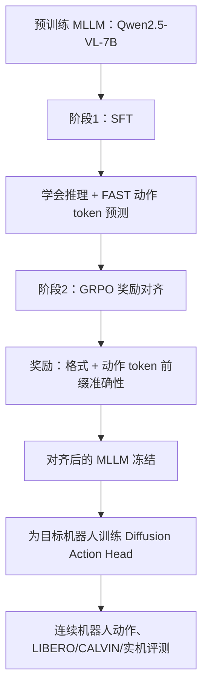

# RoboAlign 第1/12节：论文概述、研究问题与整体思路

- 学习开始：2026-10-18（第1周开始前预习）
- 进度：**第1节已提供讲解；学习者理解情况尚未验收**
- 论文：[RoboAlign: Learning Test-Time Reasoning for Language-Action Alignment in Vision-Language-Action Models](https://arxiv.org/abs/2603.21341)，2026-03-22，arXiv:2603.21341v1
- 对照：[MobileVLA-R1 2.0](https://arxiv.org/abs/2609.06251)
- 完整课程：[RoboAlign 12节路线](../ROBOALIGN-12-LESSONS.md)；[本周双论文安排](../ROADMAP-8-WEEKS.md)
- 来源：本文概述来自论文摘要、§1、§4、§5；**作者的实验结果不等于我们的复现实验**。

## 1. 用一句话认识论文

**RoboAlign 训练视觉语言模型，使其生成的推理与正确的机器人底层动作产生更直接的关联；再把这个经过对齐的模型用作 VLA 的语言视觉底座，改善实际控制成功率。**

主要问题并非“机器人完全不理解语言”，而是**具身推理能力与实际动作能力之间有落差**。模型可能会回答“应该把杯子抓起来”，却没有学会该往哪里移动、何时收拢夹爪。作者在引言中指出，部分视觉问答增强的 MLLM 推理更强，却没有改善后续机器人控制表现，甚至恶化。

## 2. 技术流程（教学简图）

SFT 先让原本不能零样本输出 FAST 动作 token 的通用模型具有基础动作表达能力；RL 再通过奖励提高动作 token 预测准确率。最终验证时，作者为每个机器人任务训练新的扩散动作头，并冻结主干。

## 3. 四个高频词

| 名称 | 当前只需理解到这一步 |
|---|---|
| MLLM | 会看图和理解语言的多模态大模型；不是完整机器人控制器 |
| VLA | 将图像、语言转换为可以执行的动作策略 |
| SFT | 监督微调，先模仿已知的示范答案与 FAST token |
| GRPO | 相同问题采样若干候选，利用奖励比较并优化模型输出 |
| FAST token | 将连续机器人动作编码成可由语言模型预测的离散 token，不是直接执行的电机命令 |
| Diffusion Action Head | 通过扩散式动作生成模块输出连续动作；后续会细讲 |

## 4. 作者的结果说明什么？

原论文 §5 报告：
- **LIBERO**：同一评测管线中，Qwen2.5-VL-7B-Instruct 主干的 VLA 基线平均成功率 73.9%，RoboAlign 达到 86.8%（增加 **12.9 个百分点**，相对提高约 17.5%）。
- **CALVIN**：作者报告相对其 SFT 比较模型的改进；检验时要对齐 ABC→D 迁移及连续任务长度指标。
- **真机**：作者报告基于机械臂的多种抓取/搬运任务有改进；**不是宇树 Go1 的验证**。
- RL 使用约 12.8K 条样本，SFT 数据约 2.28M 条；“较少强化学习数据”不代表“整个训练只需 12.8K 条数据”。

作者还在论文 §5.3 检验另一种 MLLM 底座 Qwen3-VL-8B。但这不说明本学习仓库已有的 Qwen3-VL 权重自动具有 RoboAlign 的已训练适配参数或能被 MobileVLA 2.0 源码直接加载。

## 5. 与 MobileVLA-R1 2.0 的关联

**共同点：** 都认为生成好看的推理文本不足以检验机器人能力，都在训练中引入与动作正确性相关的监督/奖励。

**区别：** MobileVLA 2.0 主要面向移动机器人，动作是速度 + 行为类别，配合机器人底层控制器；RoboAlign 主要面向机械臂操作，用 FAST token 在语言主干训练阶段建立动作关联，随后另训扩散动作头。因此两篇模型权重、动作空间和评测指标不能直接互换。

## 6. 学完这节应能答出的三个问题

1. RoboAlign 解决的究竟是“语言无法理解”还是“语言推理难以转化成准确动作”？
2. 为什么 RoboAlign 需要 SFT、GRPO、再训练扩散动作头，而不是只靠提示词？
3. 从机械臂任务迁移到宇树 Go1 时，哪些只是通用思想，哪些动作定义必须重新设计？

**下一节：第2/12节——论文整体架构与 SFT 基础。** 本节暂无本地代码实验与验收结果。

之前涉及 GRPO 和前缀奖励的预习材料见 [扩展预习笔记](week01-preview-action-alignment.md)；正式公式推导放在第4节。
